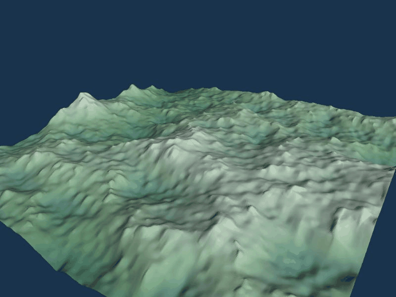
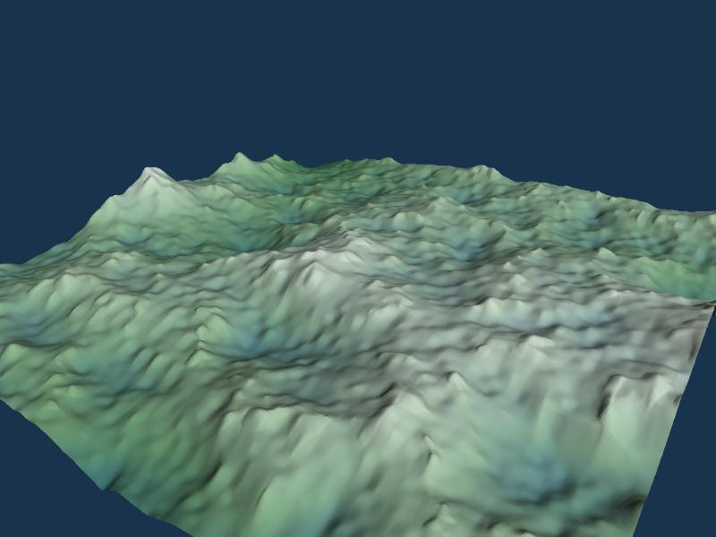
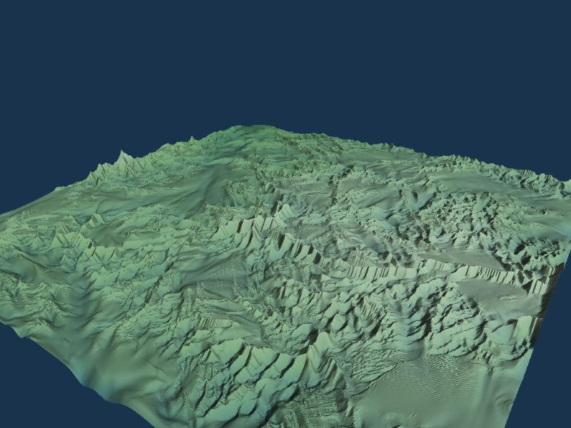
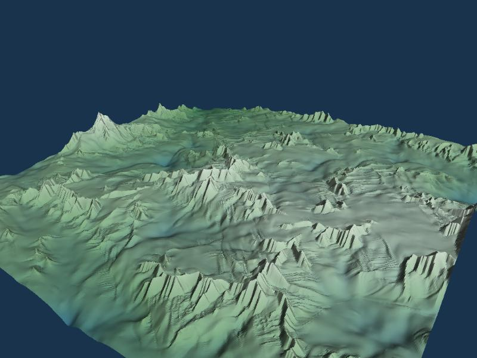
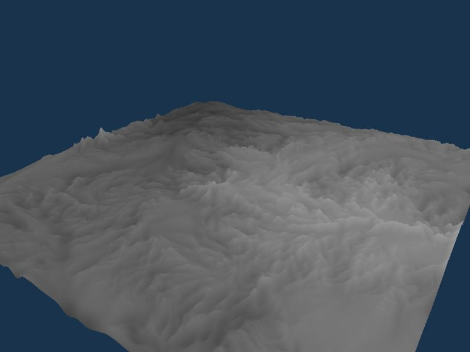
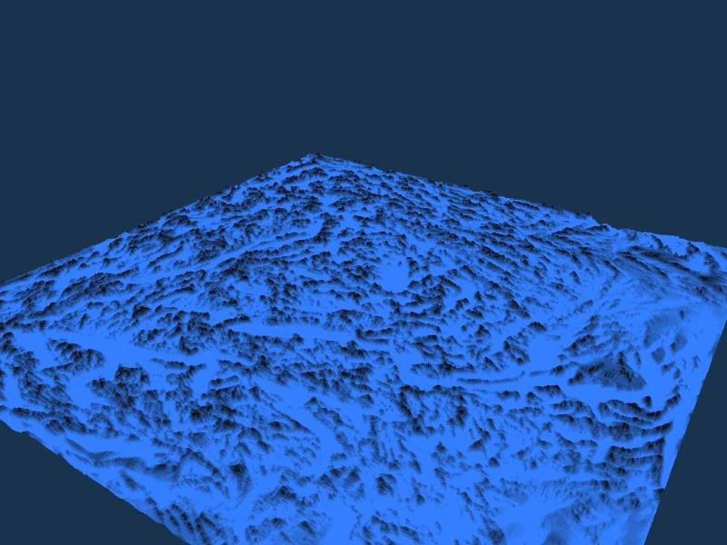

# WebGPU Biome Simulator

Erosion, ecology and procedural flowers, all on the GPU in the browser.
CIS 5650 final project, Fall 2026. Anna Dai, Lilian Xiao, Ximing Luo.

Terrain is shaped by hydraulic erosion, an ecosystem pass decides which plant species
lives where and when it dies, and the flowers themselves are generated on the GPU and
drawn with indirect instancing. No 3D assets are downloaded.

## Run

```
npm install
npm run dev
```

Open `http://localhost:5173/?track=<name>`. Needs a browser with WebGPU (Chrome 113+).

## Tracks

Each Milestone 1 track is a class in `src/tracks/` registered in `src/main.ts`.

| track | owner | what it shows |
|---|---|---|
| `clear` | | placeholder, clears to a color |
| `erosion` | Anna | fBm heightfield, Mei '07 hydraulic erosion + thermal erosion, height/moisture export (branch `erosion`) |
| `parametric` | Lilian | GPU-generated parametric flower (branch `parametric`) |
| `ecosystem` | Ximing | species placement over terrain, live/die time stepping, compacted plant instances drawn indirectly |

### Erosion track

Planned for M1: terrain + one erosion pass. Done:

- full Mei et al. 2007 hydraulic erosion pipeline
- thermal erosion and a water-depth factor on erosion strength, both from Jákó & Tóth 2011 (not in Mei '07)

Passes per step: rain -> flux -> water -> erosion/deposition -> sediment transport -> thermal, then an export pass writes the shared height and moisture textures.

State:
- ping-ponged `rgba32float` textures: height / water / sediment, and flux in four directions
- one `rg32float` velocity texture

GUI: `view` switches between shaded, height and moisture; the Simulation folder exposes every rate constant.

Thermal erosion is there because hydraulic erosion alone is unstable on a grid:
- if two neighboring cells differ slightly in height, the lower one collects more water, erodes faster and gets lower still
- the slope term can't stop this, because a central-difference gradient can't see an every-other-cell pattern
- left running, the terrain turns into a field of one-cell pillars within about a minute

The fix has two parts:

- thermal erosion: material steeper than the talus angle slides downhill, so pillars collapse as fast as they form
- water-depth factor: a thin film of rain carves nothing, so only concentrated flow erodes



| Initial (t = 1 s) | After 30 s |
| --- | --- |
|  |  |

| Shaded close-up | Height view | Moisture view |
| --- | --- | --- |
|  |  |  |

*All captures: 512 x 512 grid, dt 0.05, 1 step/frame at ~60 fps; rain 0.02, pipe 1.0, Kc 0.05, Ks 0.3, Kd 0.5, Ke 0.5, Kt 0.5, talus 0.01, maxDepth 0.01. The moisture view uses moistureScale 25 instead of the default 2. Taken before the velocity clamp fix; with the clamp active the same look needs Kc 0.01, which is now the default.*

### Ecosystem track

Rules follow Cordonnier et al. 2017, cut down to live or die. Every cell scores each species
on height, slope and moisture. Empty cells get seeded from plants nearby, occupied cells age
and die faster the worse they fit. `play` steps the simulation, `view` switches between the
shaded scene and the height, moisture, slope, species and viability maps.

## Shared layout

Defined in `src/core/layout.ts` so the three tracks merge cleanly:

- grid 512 x 512 cells over a 100-unit world
- height and moisture: `r32float` textures, values in [0, 1]
- plant state: `rgba8uint` texture, r = species (0 empty), g = age, b = viability
- `PlantInstance`: 32 bytes, position, species, rotation, age, viability
- indirect draw args, instance count filled on the GPU

## References

- G. Cordonnier et al., *Authoring Landscapes with Semi-Automatic Ecosystem Generation*, ACM TOG 2017
- X. Mei, P. Decaudin, B.-G. Hu, *Fast Hydraulic Erosion Simulation and Visualization on GPU*, Pacific Graphics 2007
- B. Jákó, B. Tóth, *Fast Hydraulic and Thermal Erosion on the GPU*, CESCG 2011

Pitch slides and milestone presentations live in `milestones/`.
