# WebGPU Biome Simulator

Erosion, ecology and procedural flowers, all on the GPU in the browser.
CIS 5650 final project, Fall 2026. Anna Dai, Lilian Xiao, Ximing Luo.

Terrain is shaped by hydraulic erosion, an ecosystem pass decides which plant species
lives where and when it dies, and the flowers themselves are generated on the GPU and
drawn with indirect instancing. No 3D assets are downloaded.

## Run

```
npm install
npm run dev
```

Open `http://localhost:5173/?track=<name>`. Needs a browser with WebGPU (Chrome 113+).

## Milestone 1

Each Milestone 1 track is a class in `src/tracks/` registered in `src/main.ts`.

| track | owner | what it shows |
|---|---|---|
| `clear` | | placeholder, clears to a color |
| `erosion` | Anna | fBm heightfield, Mei '07 hydraulic erosion + thermal erosion, height/moisture export (branch `erosion`) |
| `parametric` | Lilian | GPU-generated parametric flower (branch `parametric`) |
| `ecosystem` | Ximing | species placement over terrain, live/die time stepping, compacted plant instances drawn indirectly |

### Erosion track

Planned for M1: terrain + one erosion pass. Done:

- full Mei et al. 2007 hydraulic erosion pipeline
- thermal erosion and a water-depth factor on erosion strength, both from Jákó & Tóth 2011 (not in Mei '07)

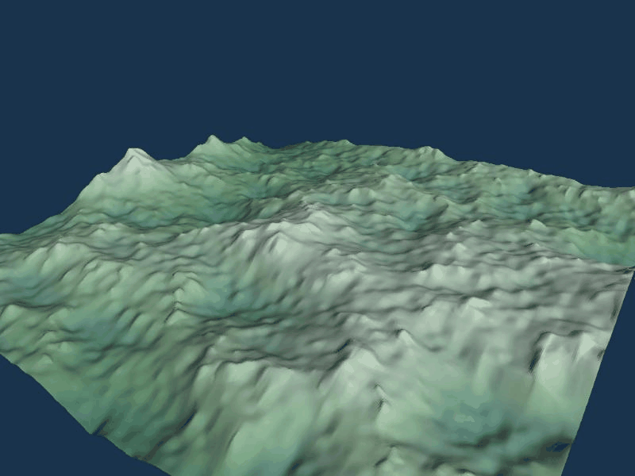

| Initial (t = 1 s) | After 30 s |
| --- | --- |
| 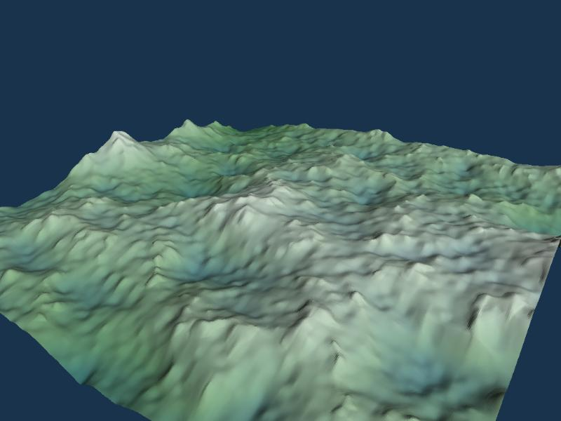 | 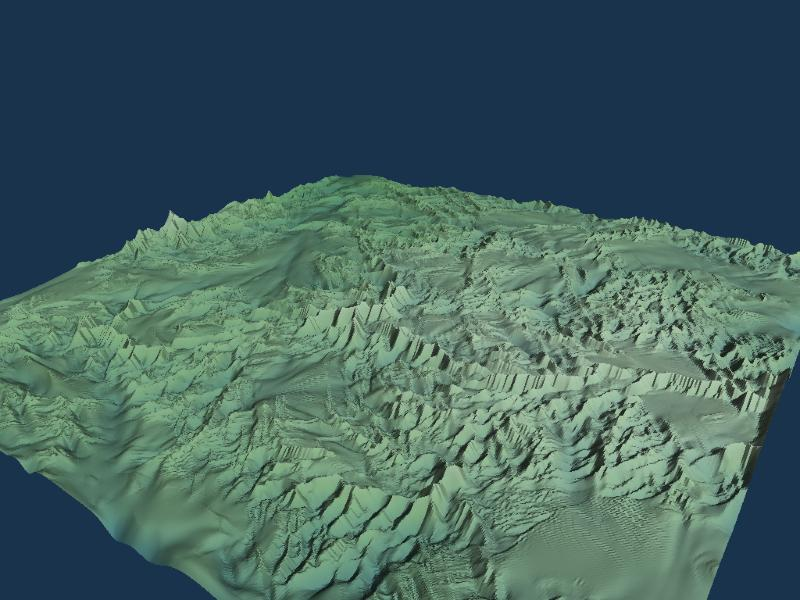 |

*Timelapse and before/after: 512 x 512 grid, dt 0.05, 1 step/frame at ~60 fps; rain 0.02, pipe 1.0, Kc 0.05, Ks 0.3, Kd 0.5, Ke 0.5, Kt 0.5, talus 0.01, maxDepth 0.01. Taken before the velocity clamp fix; with the clamp active the same look needs Kc 0.01, the M1 default.*

Passes per step: rain -> flux -> water (moves the water and the sediment it carries) -> erosion/deposition -> evaporation -> thermal, then an export pass writes the shared height and moisture textures. At M1 sediment moved in its own semi-Lagrangian transport pass; M2 replaced it (see below).

State:
- ping-ponged `rgba32float` textures: height / water / sediment, and flux in four directions
- one `rg32float` velocity texture

Thermal erosion is there because hydraulic erosion alone is unstable on a grid:
- if two neighboring cells differ slightly in height, the lower one collects more water, erodes faster and gets lower still
- the slope term can't stop this, because a central-difference gradient can't see an every-other-cell pattern
- left running, the terrain turns into a field of one-cell pillars; by 18 000 steps it is pillars everywhere (left image below)

The fix has two parts:

- thermal erosion: material steeper than the talus angle slides downhill, so pillars collapse as fast as they form
- water-depth factor: a thin film of rain carves nothing, so only concentrated flow erodes

| Kt = 0 (no thermal) | Kt = 0.5 (default) |
| --- | --- |
| 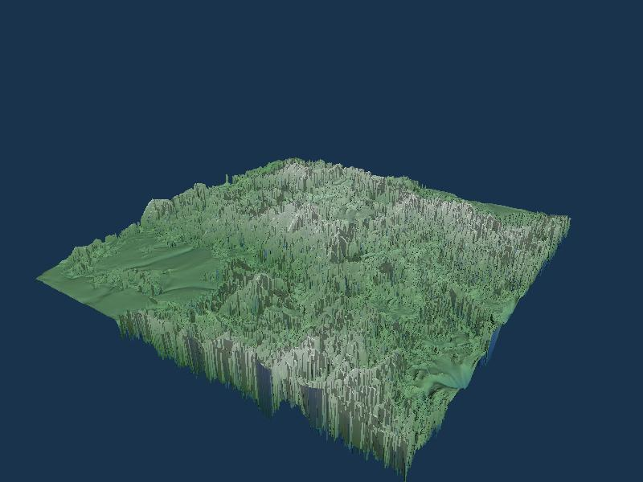 | 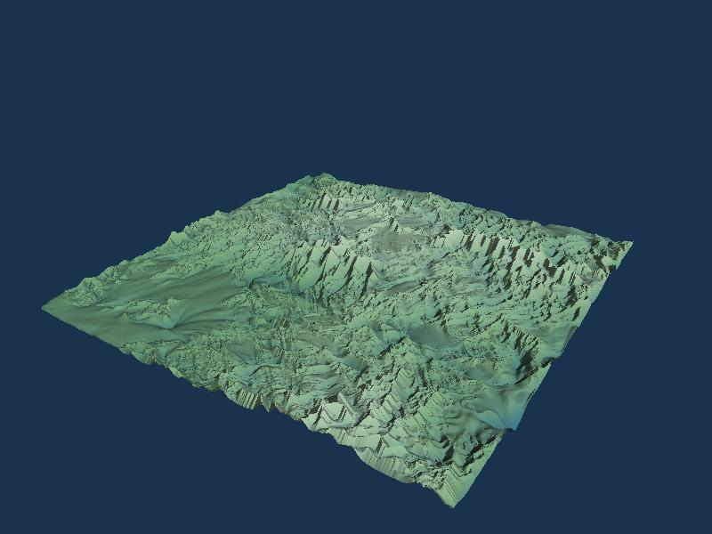 |

*Same seed (1) and camera, 18 000 steps each (20 steps/frame for 900 frames), all other parameters default.*

GUI: `view` switches between shaded, height and moisture; the Simulation folder exposes every rate constant.

| Shaded close-up | Height view | Moisture view |
| --- | --- | --- |
| 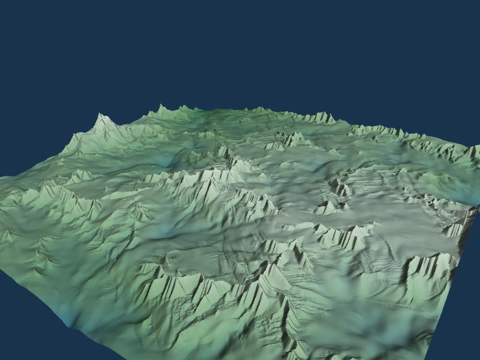 | 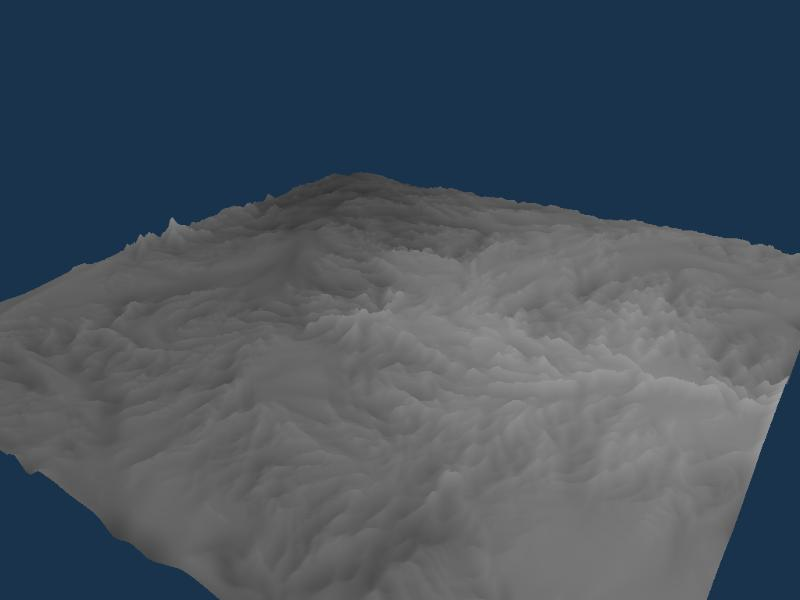 | 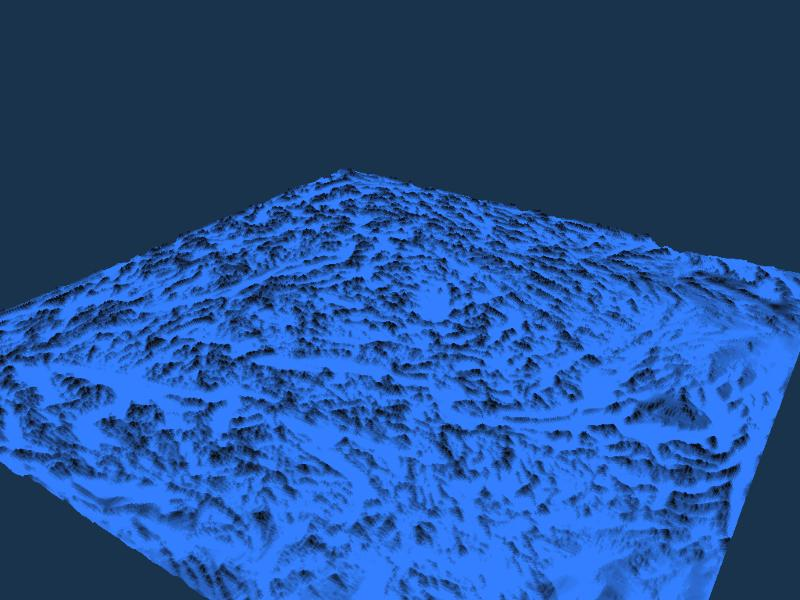 |

*Same settings as the timelapse, except moistureScale 25 (M1 default 2) for the moisture view.*

M1 timing (the M1 passes and defaults, before the M2 transport rewrite): one full sim step took about 0.12 ms on the GPU at 512 x 512, under 1% of a 60 fps frame. No single pass dominates: water is the slowest at about 20% of the step, and every pass is a full-grid read and write of float textures, so the cost is spread evenly. Timed with `?track=erosion&bench=300&steps=10&warmup=600&csv`, which records GPU timestamps around each pass of the first step in a frame.

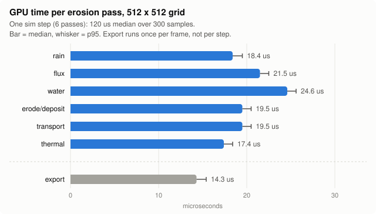

*NVIDIA RTX 3090 Ti, AMD Ryzen 9 5950X, Windows 11 25H2, Chrome 157. 10 steps/frame to keep the GPU clock steady; only the first step of each frame is timed. Median of 300 samples, raw data in `media/erosion/erosion_timing_512.csv`. Needs Chrome's WebGPU developer features flag; without it timestamps are coarsely quantized (65 us steps on this machine) and these numbers are meaningless.*


### Ecosystem track

Planned for M1: species placement over a terrain and a live or die time step. Done, on a stand-in terrain until the erosion track merged.

Rules follow Cordonnier et al. 2017, cut down to live or die. Every cell scores each species
on height, slope and moisture. Empty cells get seeded from plants nearby, occupied cells age
and die faster the worse they fit.

Everything runs on the GPU in three passes:

- step: one compute pass over the 512 x 512 grid applies the rules to every cell
- compact: a second pass packs the living plants into one instance list and counts them
- draw: one indirect draw call for all plants, so the CPU never learns how many there are

`play` steps the simulation, `view` switches between the shaded scene and the height,
moisture, slope, species and viability maps.

### Parametric track

Moving from the terrain and ecosystem to actual parametric flowers.  In the pipeline, the terrain is drawn first, and then the plants are drawn in a single indirect call.  This ensures that the CPU is never responsible for how many plants there are, or any vertex geometry information.  Similar parametric no-geometry mesh ideation as with the Kuth et. al. (2025) Real Time GPU Tree Generation paper.  This step replaces the dummy placeholder vertex shader flowers previously used for testing.

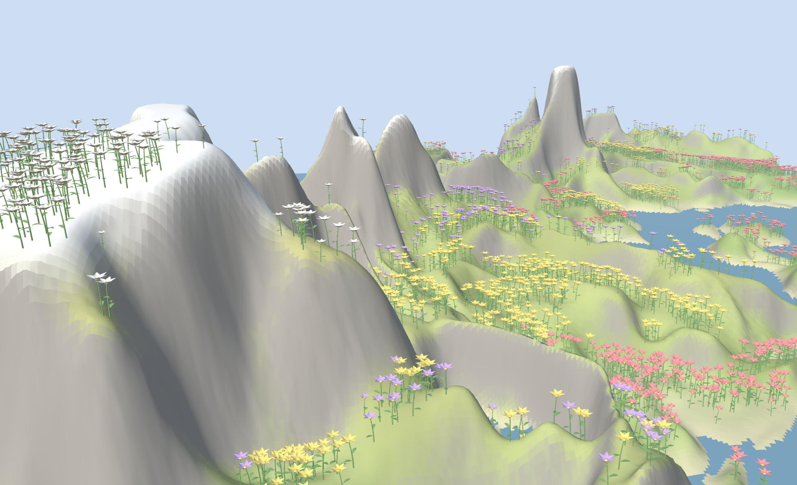

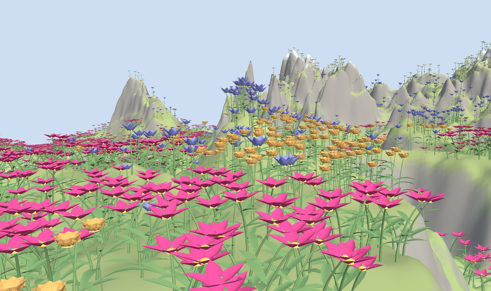

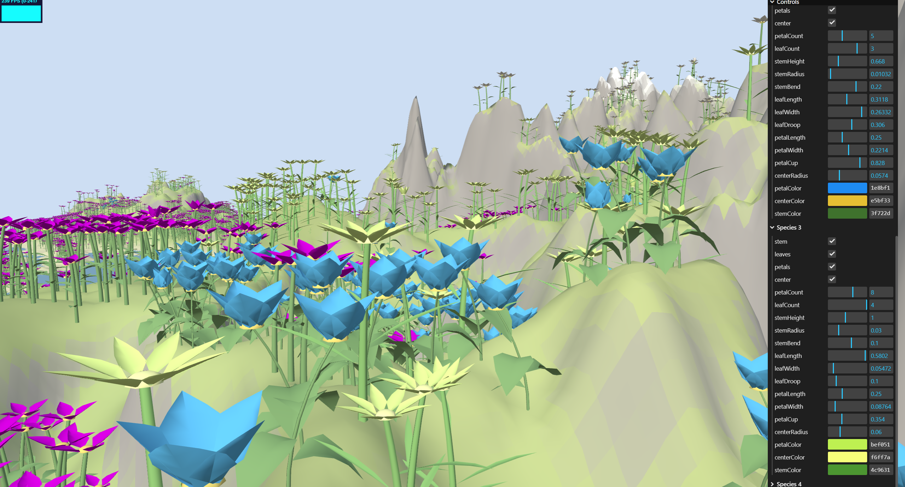

Each flower reads its “vertex instance”, looks up its flower species for the correct parameters, then decodes the vertex index into a specific part (stem, leaf, etc.).  Vertex indices are separated into these patches; quads defined by some uv, usually u is part length and v is part breadth.

The uv is simply discarded if toggled off, but if toggled on, is calculated positionally using a placement surface function unique to each part of the plant.  This is how the stem is placed first, then the leaves going along the stem, then the disc center and the petals.  A plant instance has position, species, age, viability attributes; specific flower params include toggles, counts, shape floats, and colors.

By keeping a shape per species, variation per instance model, we can keep flowers as fixed sets of parts.  lil gui then edits flower species object and packs all four species into one write buffer.  Ultimately, no geometry is stored, allowing for massive flower instancing.

## Milestone 2

### Anna: erosion in the ecosystem, rain and clouds

Planned: connect live erosion to the ecosystem, and add moving procedural clouds and visible rain tied to the rain-rate control. All three are done. Two fixes came up during the integration, conservative sediment transport and open map edges.

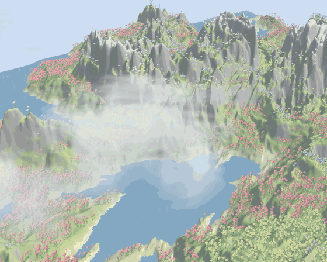

#### Erosion in the ecosystem

`?track=ecosystem` now runs on the live erosion sim instead of the noise stub. Add `&terrain=stub` to get the stub back. The sim is its own class in `src/sim/` and writes into textures the caller passes in, so any track can drive it. It also shares the shader prelude with the ecosystem, so both use the same fBm noise.

- the starting terrain uses the same shaping as the stub, so a seed gives the same map either way
- moisture is a height/noise baseline plus a moving average of water depth, so species follow where water actually flows. The time constant `moistureTau` is in sim seconds and does not depend on dt or steps per frame
- `pause erosion` freezes the terrain while rain, flow and evaporation keep running. Erosion works on geological time and the ecosystem on seasons, so the terrain is shaped first and then held still
- the slope term now uses world units. Before, slopes were underestimated by a factor of `HEIGHT_SCALE` (18)
- water lasts about 670 steps instead of 40 (Ke 0.5 -> 0.03), long enough to reach the valleys

| Noise stub (`&terrain=stub`) | Eroded, paused at 30k steps |
| --- | --- |
| 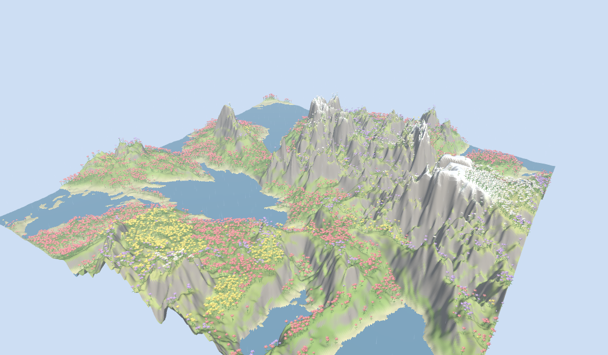 | 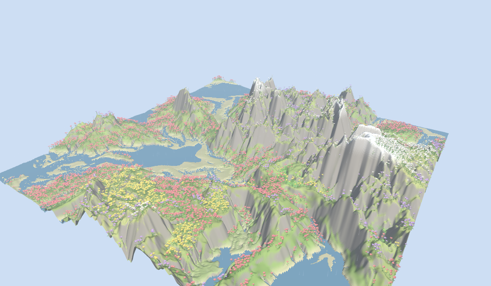 |

*Seed 1, default camera and sim settings, clouds hidden.*

#### Rain and clouds

Both show up in the gif above.

- rain is drawn as instanced streaks with no vertex buffer. The streak count follows the sim's `rainRate`, up to 20 000 at the slider max
- clouds are a few stacked layers of domain-warped fBm that drift with the wind and fade out past the map edge. Higher layers use a higher cutoff, so the stack narrows toward the top

`cloudDensity()` is in the shared `common.wgsl`, so other passes can sample the same cloud pattern, for example for a cloud-driven rain map or cloud shadows in M3. For now rain falls over the whole map and does not follow the clouds.

#### Fix: conservative sediment transport

At M1 the transport pass moved sediment with semi-Lagrangian advection, where each cell samples the sediment upstream along its velocity. Sampling does not conserve mass. A probe (`?probe`, which logs grid totals of land, sediment and water once a second) showed the land losing about 95% of its mass in 100k steps.

Now sediment moves with the water in the water pass. Water flows between neighbors through four virtual pipes per cell (the flux texture from M1). Each pipe carries sediment in proportion to its water flow and the sender's concentration, so whatever one cell sends, its neighbor receives. Land plus sediment is conserved between cells, and the only way out is the map edge, covered in the next section. The transport pass now only evaporates.

#### Fix: open sea boundary

The map edges used to be closed, so sediment could never leave and every basin silted up. The ecosystem draws water wherever height <= `WATER_LEVEL` (0.05), so lakes disappeared as their floors filled.

Now the neighbor past the edge is the sea.

- sea edges drain to sea level, and dry-land edges see level ground past them, so the map does not end in a cliff. The outside water surface is `max(WATER_LEVEL, own bed height)`
- edge cells are topped up to `WATER_LEVEL`, and water that flows out through the edge pipes takes its sediment with it
- the initial terrain already falls below `WATER_LEVEL` toward the edges, so the fixed water plane is now the sim's actual sea level

| Closed edges, 66k steps | Open edges, 66k steps |
| --- | --- |
| 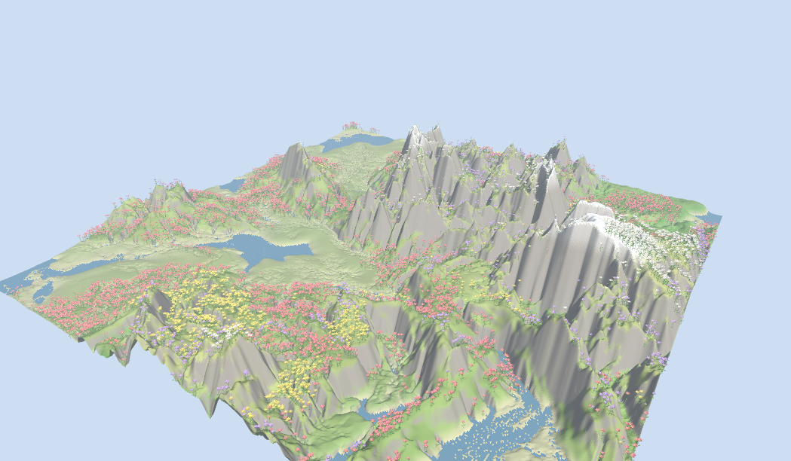 | 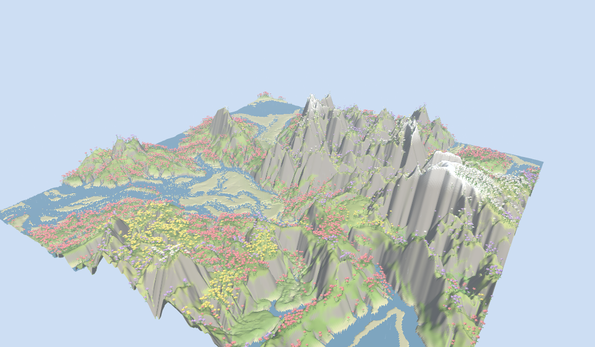 |

| Cells at or below `WATER_LEVEL` | start | 66k steps | 150k steps |
| --- | --- | --- | --- |
| closed edges | 19.7% | 7.2% | 0.9% |
| open edges | 19.8% | 19.4% | 25.2% |

*Default sim settings, 512 x 512. Images use seed 1 and the default camera, with erosion paused at 66k steps and clouds hidden.*

With open edges, land is no longer conserved. What leaves is sediment that water carries off the map, not a numerical error. Over 150k steps the mean land height drops by about 11%, and about 59% of the eroded material leaves within the first 40k steps. Inland basins with no path to the edge still fill up. Drawing water from the sim's water depth instead of a fixed level could be a potentail M3 fix.

### Ximing: walking, wind, population census, lifecycle

Planned: ground-level navigation, wind controls with flower sway, a check of where species grow on the eroded terrain, per-species population counts on the GPU with seeding and mortality verified, and lifecycle state for flower animation. All of it is done. Three fixes came up while checking the merged terrain: soil creep in the erosion, a limit on the erosion time step, and flooded plants.

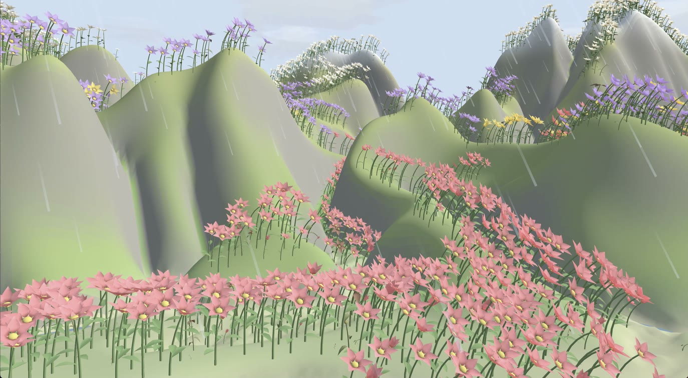

*Seed 1 at 60k erosion steps, wind strength 1.9, rain rate 0.002, soil creep 0.002.*

#### Walking and wind

- `walk (WASD)` puts the camera at eye height. Drag to look, WASD to move, Shift to run. The terrain only exists on the GPU and erosion rewrites it every frame, so the height under the camera is read back one texel at a time and the camera eases toward it
- the `Wind` folder sets one direction and strength for the whole scene. Flowers bend downwind along an arc from the base to the top of the stem, so leaves and the head tilt with it, in gusts that travel with the wind. Clouds drift along it and rain streaks slant with it, and neither has a speed or direction setting of its own
- the shaded view decides water from the height of the surface at each pixel instead of once per cell, which removes a saw-tooth edge along steep shores

#### Population census

`showPopulation` opens a panel with one row per species: living plants, their mean viability, and habitat, the share of the map the species could live on. A compute pass counts all of it every frame and 144 bytes are read back. It also runs while the ecosystem is paused, so habitat follows the erosion live.

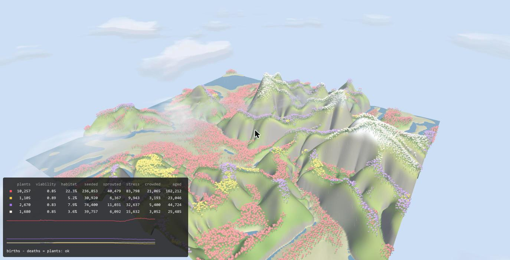

*Seed 1 at 60k erosion steps with `play` on.*

The step pass also counts births, split into seeded by a neighbour and sprouted from the seed bank, and deaths by cause: stress, crowding and old age. Two checks come out of that:

- every living plant was born once and has not died, so births minus deaths must equal the count. The panel checks this on every update. It held through reseeds, seed changes and species-count changes
- the stress rule is `mortality x (1 - viability)`. With mortality 0.04 and the measured mean viability it predicts 0.00521 deaths per plant per step. Counted over 1,001 steps on about 13,600 plants it was 0.00514. The gap is the 1.2% of plants that old age takes first each step

Viability now takes the weakest of its factors instead of their product, which is the rule in Cordonnier et al. 2017.

Census cost on the GPU, timed with the pass timer from the erosion track (`?track=ecosystem&bench=300&steps=20&tile=N`):

| Cells summed per thread | Pass time |
| --- | --- |
| 1 x 1 | 23.9 us |
| 2 x 2 (default) | 22.6 us |
| 4 x 4 | 26.8 us |
| 8 x 8 | 65.4 us |

*RTX 4070 Laptop, 512 x 512, seed 1, about 11,000 plants. Chrome's WebGPU developer features flag was off, so timestamps are rounded to 65.5 us. Each figure is the mean of 800 to 2,200 samples and should be rerun with the flag on.*

- skipping atomic adds of zero is what made it cheap. The per-cell version took 78.2 us before that and 23.9 us after
- summing a block of cells per thread did not help beyond that, and from 8 x 8 up it hurts, because each thread walks its block one cell at a time and too few threads share the work. An earlier version took 4 ms at 64 x 64

#### Lifecycle state

A plant that dies no longer vanishes in one step. It wilts first, then its cell frees up. The lifecycle itself is Lilian's: each plant gets its own lifespan and its own wilt length, 3 to 15 steps, and her flower shader animates growth, bloom and wilting from it. The state texture's alpha channel holds the plant's seed and the wilt steps left.

The ecosystem side fits onto that. A wilting plant keeps its cell but neither seeds nor crowds its neighbours. The census counts wilting plants apart from living ones, and a death is counted when the wilt starts. The `lifecycle` view shows age and wilting per cell.

#### Where species grow on the eroded terrain

The `habitat` view colors every cell by the species that fits it best, occupied or not, next to the `species` view of where plants are.

| | Species 1 | Species 2 | Species 3 | Species 4 | All |
| --- | --- | --- | --- | --- | --- |
| Habitat before erosion | 23.3% | 7.9% | 8.5% | 2.8% | 42.5% |
| Habitat at 30k steps | 20.0% | 5.8% | 8.0% | 3.0% | 36.8% |
| Viability at 30k steps of plants placed before erosion | 0.61 | 0.55 | 0.58 | 0.73 | |
| Viability after reseeding and 300 steps of `play` | 0.88 | 0.89 | 0.83 | 0.85 | |
| Plants after reseeding and 300 steps of `play` | 8,675 | 1,224 | 2,433 | 1,257 | 13,589 |

*Seed 1, default settings, 512 x 512.*

All four species keep habitat on the eroded map. A placement made before erosion goes stale, and with `play` on the population sorts itself back onto ground that fits.

#### Fix: soil creep

Left running, the erosion turned all land into needles. Measuring the steepest slope at every land cell showed why. The share of land at 60 to 70 degrees went from 12.9% before erosion to 52.0% at 100k steps. Water erosion only cuts where water is deep and fast, so channels keep deepening while the ground between them never erodes, and the thermal pass only moved material on slopes steeper than the talus limit of 66 degrees. All land steepened up to that limit and stopped there.

The thermal pass now also has soil creep, a small flow down every slope (`soil creep` under Thermal erosion, default 0.002). Lowering the talus limit was tried first and only turned 66 degree needles into 43 degree pyramids.

The first default was 0.004, which smoothed too much. The hills rounded off, and only 41% of the fine detail of the un-eroded terrain was left at 100k steps, against 64% at 0.002.

| No creep, 100k steps | Creep 0.002, 100k steps |
| --- | --- |
| 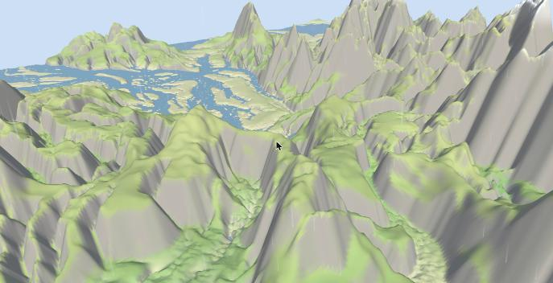 | 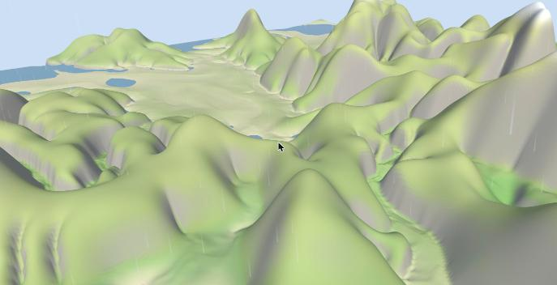 |

| At 100k steps | No creep | Creep 0.002 | Creep 0.004 |
| --- | --- | --- | --- |
| Land at 60 to 70 degrees | 52.0% | 26.6% | 18.0% |
| Spikes per 1,000 land cells | 13.4 | 2.7 | 0.6 |

*Seed 1, default settings, same camera. A spike is a land cell more than 0.003 above all four neighbours. Fine detail is the mean difference between a land cell and the average of its four neighbours. With creep 0.002 the highest point drops from 0.992 to 0.950.*

Erosion still never settles. Land keeps leaving through the sea edges, and faster with creep on long runs: 37.1% of the map is under water at 400k steps against 29.5% without, and the share of land at 60 to 70 degrees is back up to 33.3% by then. Pausing erosion is still how a map is kept.

#### Fix: time step limit

Raising the erosion `time step (dt)` covered the ground in a dotted texture. The water passes are explicit, and past a step of `cell size / (2 x sqrt(flow speed))`, 0.098 at the defaults, the water depth breaks into a checkerboard that the moisture map copies. The ground height itself does not get rougher. Raising `flow speed` does the same thing at the default step. The simulation now holds the step at 90% of that limit whatever the two sliders say.

| dt | Flow speed | Limit | Water roughness |
| --- | --- | --- | --- |
| 0.095 | 1 | 0.098 | 0.11 |
| 0.10 | 1 | 0.098 | 1.26 |
| 0.05 | 6 | 0.040 | 1.04 |
| 0.20 | 0.2 | 0.218 | 0.08 |

*Seed 1, 300 simulated seconds each, measured before the limit was added. Water roughness is the mean difference between a wet cell's depth and the average of its four neighbours, over the mean depth. With the limit, dt 0.2 gives 0.13 and flow speed 6 gives 0.19.*

#### Fix: flooded plants

Plants are placed once and erosion keeps moving the coast, so with `play` off some ended up standing in the sea. The compact pass now skips a plant when the ground under it is at or below the water level, so it is not drawn. The simulation still holds it, and it dies at the normal rate once `play` is on. At 400k steps with `play` off, 3,284 of 11,070 plants were in flooded cells.

### Lilian: parametric tuning, lifecycle animations, optimization, and shading

#### Plant lifecycle animation

Smooth motion is done between animation steps. Growth, opening and wilt are evaluated using plant age and a step phase through the plant’s life cycle, so they move every frame instead of jumping each step.  Each plant instance now possesses position, species, rotation, size, petal openness, and wilt.  The size combines growth, viability, wilt shrinking, and cull fading parameters.

#### Flower shading

Flowers are now subjected to a per-part shader that more rigorously colors each petal, with slight transmission to help the effect of petal thinness, gradient coloration across each petal, sin-based petal veining, ambient and fog lighting, and health-based translucency.  An array of parameters affect the shading of each flower; translucency lessens as a petal wilts, simulating flower dryness as it approaches death.  Transmissive light is stronger at thin edges and when facing the sun, tinted by albedo for saturation.


#### Wilting and browning

The vertex shader is improved to modify each species' FlowerParams locally, as the wilt parameter goes from 0 to 1.  The stem bends further, and the head frame follows (center and petals); the petals droop below the horizontal and each petal will randomly drop, seeded by plant rotation.  This is because the instance index changes order per frame.  Brown wilting and size shrinking is applied to a flower as it approaches death.  VSOut carries patch uv information, part type, a per-petal variation value (for petal jittering), and wilt value to the fragment shader.


#### Fix: Plant culling

A considerably large simulation of unculled flowers can be significantly slow.  A bounding sphere is computed per species on the CPU, then stored in two parameters (bounding center and radius), scaled per plant by its size.  A frustum test is run against six planes from the viewProj matrix rows, using [Gribb-Hartmann's method for extracting view-frustum planes](https://www.gamedevs.org/uploads/fast-extraction-viewing-frustum-planes-from-world-view-projection-matrix.pdf).  A screen size test is run using the projected radius; plants under 1 pixel are culled, and between 1-4 pixels, they are shrunk using a fade factor, so there is no abrupt visual culling behavior.

The above describes the whole-flower culling method.  There is an additional per-part culling method, partVisible, that drops a plant part when its on-screen size falls below a per-part size threshold.  Leaves: 3 px, petals: 1.5 px, center: 1 px, and the stem is culled only if the entire flower must be culled.  This improves rasterization and per-pixel work, whereas whole flower culling addresses improved vertex work.

A freeze-culling tool is toggleable as a debug option to help visualize with and without culling.


#### Fix: Plant head frame rotation

Originally, petals did not follow stem orientation.  This has since been corrected by adding stem-tip rotation offset using the stem spine function, which is applied to the petal and center positions.  Plants are no longer flat and uniform.


## Shared layout

Defined in `src/core/layout.ts` so the three tracks merge cleanly:

- grid 512 x 512 cells over a 100-unit world
- height and moisture: `r32float` textures, values in [0, 1]
- plant state: `rgba8uint` texture, r = species (0 empty), g = age, b = viability, a = plant seed in the low 4 bits and wilt steps left in the high 4 (0 healthy)
- `PlantInstance`: 32 bytes, position, species, rotation, size, open, wilt
- `Wind`: 24-byte uniform with direction, offset, strength and time, bound by the flowers, clouds and rain
- indirect draw args, instance count filled on the GPU

## References

- G. Cordonnier et al., *Authoring Landscapes by Combining Ecosystem and Terrain Erosion Simulation*, ACM TOG 36(4), 2017
- X. Mei, P. Decaudin, B.-G. Hu, *Fast Hydraulic Erosion Simulation and Visualization on GPU*, Pacific Graphics 2007
- B. Jákó, B. Tóth, *Fast Hydraulic and Thermal Erosion on the GPU*, CESCG 2011

Pitch slides and milestone presentations live in `milestones/`.
