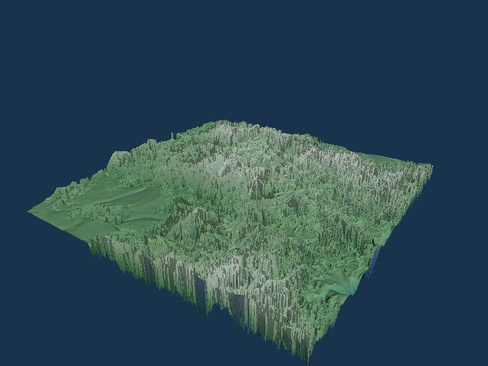
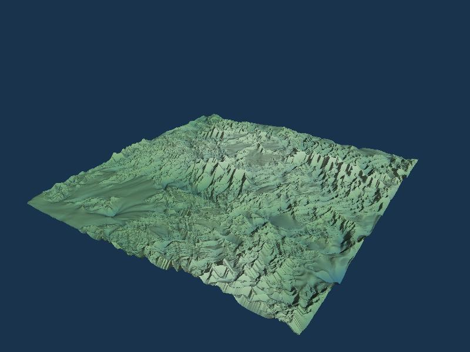
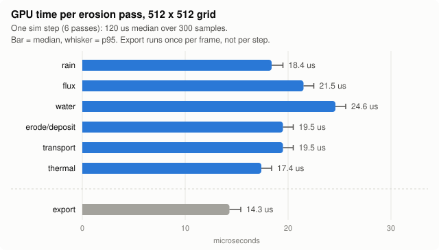
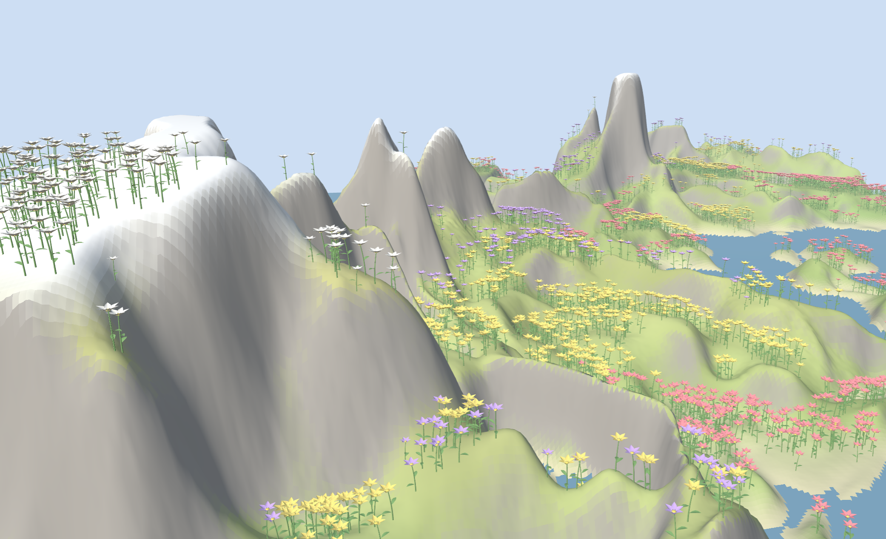
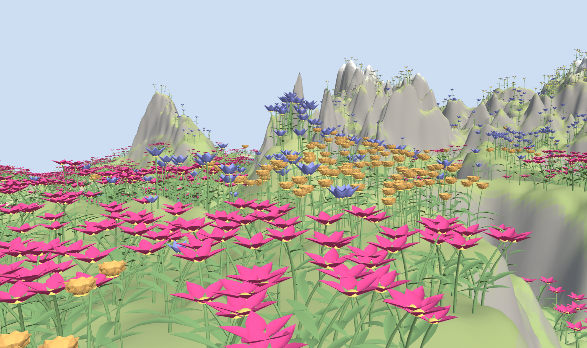
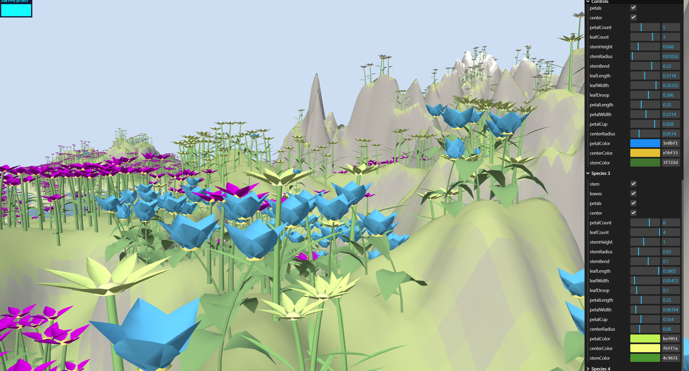

# WebGPU Biome Simulator

Erosion, ecology and procedural flowers, all on the GPU in the browser.
CIS 5650 final project, Fall 2026. Anna Dai, Lilian Xiao, Ximing Luo.

Terrain is shaped by hydraulic erosion, an ecosystem pass decides which plant species
lives where and when it dies, and the flowers themselves are generated on the GPU and
drawn with indirect instancing. No 3D assets are downloaded.

## Run

```
npm install
npm run dev
```

Open `http://localhost:5173/?track=<name>`. Needs a browser with WebGPU (Chrome 113+).

## Tracks

Each Milestone 1 track is a class in `src/tracks/` registered in `src/main.ts`.

| track | owner | what it shows |
|---|---|---|
| `clear` | | placeholder, clears to a color |
| `erosion` | Anna | fBm heightfield, Mei '07 hydraulic erosion + thermal erosion, height/moisture export (branch `erosion`) |
| `parametric` | Lilian | GPU-generated parametric flower (branch `parametric`) |
| `ecosystem` | Ximing | species placement over terrain, live/die time stepping, compacted plant instances drawn indirectly |

### Erosion track

Planned for M1: terrain + one erosion pass. Done:

- full Mei et al. 2007 hydraulic erosion pipeline
- thermal erosion and a water-depth factor on erosion strength, both from Jákó & Tóth 2011 (not in Mei '07)


| Initial (t = 1 s) | After 30 s |
| --- | --- |
|  |  |

*Timelapse and before/after: 512 x 512 grid, dt 0.05, 1 step/frame at ~60 fps; rain 0.02, pipe 1.0, Kc 0.05, Ks 0.3, Kd 0.5, Ke 0.5, Kt 0.5, talus 0.01, maxDepth 0.01. Taken before the velocity clamp fix; with the clamp active the same look needs Kc 0.01, which is now the default.*

Passes per step: rain -> flux -> water -> erosion/deposition -> sediment transport -> thermal, then an export pass writes the shared height and moisture textures.

State:
- ping-ponged `rgba32float` textures: height / water / sediment, and flux in four directions
- one `rg32float` velocity texture

Thermal erosion is there because hydraulic erosion alone is unstable on a grid:
- if two neighboring cells differ slightly in height, the lower one collects more water, erodes faster and gets lower still
- the slope term can't stop this, because a central-difference gradient can't see an every-other-cell pattern
- left running, the terrain turns into a field of one-cell pillars; by 18 000 steps it is pillars everywhere (left image below)

The fix has two parts:

- thermal erosion: material steeper than the talus angle slides downhill, so pillars collapse as fast as they form
- water-depth factor: a thin film of rain carves nothing, so only concentrated flow erodes

| Kt = 0 (no thermal) | Kt = 0.5 (default) |
| --- | --- |
|  |  |

*Same seed (1) and camera, 18 000 steps each (20 steps/frame for 900 frames), all other parameters default.*

GUI: `view` switches between shaded, height and moisture; the Simulation folder exposes every rate constant.

| Shaded close-up | Height view | Moisture view |
| --- | --- | --- |
|  |  |  |

*Same settings as the timelapse, except moistureScale 25 (default 2) for the moisture view.*

One full sim step takes about 0.12 ms on the GPU at 512 x 512, under 1% of a 60 fps frame. No single pass dominates: water is the slowest at about 20% of the step, and every pass is a full-grid read and write of float textures, so the cost is spread evenly. Timed with `?track=erosion&bench=300&steps=10&warmup=600`, which records GPU timestamps around each pass of the first step in a frame.



*NVIDIA RTX 3090 Ti, AMD Ryzen 9 5950X, Windows 11 25H2, Chrome 157. 10 steps/frame to keep the GPU clock steady; only the first step of each frame is timed. Median of 300 samples, raw data in `media/erosion/erosion_timing_512.csv`. Needs Chrome's WebGPU developer features flag; without it timestamps are coarsely quantized (65 us steps on this machine) and these numbers are meaningless.*


### Ecosystem track

Rules follow Cordonnier et al. 2017, cut down to live or die. Every cell scores each species
on height, slope and moisture. Empty cells get seeded from plants nearby, occupied cells age
and die faster the worse they fit. `play` steps the simulation, `view` switches between the
shaded scene and the height, moisture, slope, species and viability maps.

### Parametric track

Moving from the terrain and ecosystem to actual parametric flowers.  In the pipeline, the terrain is drawn first, and then the plants are drawn in a single indirect call.  This ensures that the CPU is never responsible for how many plants there are, or any vertex geometry information.  Similar parametric no-geometry mesh ideation as with the Kuth et. al. (2025) Real Time GPU Tree Generation paper.  This step replaces the dummy placeholder vertex shader flowers previously used for testing.







Each flower reads its “vertex instance”, looks up its flower species for the correct parameters, then decodes the vertex index into a specific part (stem, leaf, etc.).  Vertex indices are separated into these patches; quads defined by some uv, usually u is part length and v is part breadth.

The uv is simply discarded if toggled off, but if toggled on, is calculated positionally using a placement surface function unique to each part of the plant.  This is how the stem is placed first, then the leaves going along the stem, then the disc center and the petals.  A plant instance has position, species, age, viability attributes; specific flower params include toggles, counts, shape floats, and colors.

By keeping a shape per species, variation per instance model, we can keep flowers as fixed sets of parts.  lil gui then edits flower species object and packs all four species into one write buffer.  Ultimately, no geometry is stored, allowing for massive flower instancing.

## Shared layout

Defined in `src/core/layout.ts` so the three tracks merge cleanly:

- grid 512 x 512 cells over a 100-unit world
- height and moisture: `r32float` textures, values in [0, 1]
- plant state: `rgba8uint` texture, r = species (0 empty), g = age, b = viability
- `PlantInstance`: 32 bytes, position, species, rotation, age, viability
- indirect draw args, instance count filled on the GPU

## References

- G. Cordonnier et al., *Authoring Landscapes with Semi-Automatic Ecosystem Generation*, ACM TOG 2017
- X. Mei, P. Decaudin, B.-G. Hu, *Fast Hydraulic Erosion Simulation and Visualization on GPU*, Pacific Graphics 2007
- B. Jákó, B. Tóth, *Fast Hydraulic and Thermal Erosion on the GPU*, CESCG 2011

Pitch slides and milestone presentations live in `milestones/`.
